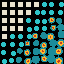

<p align="center">
  
</p>

<h1 align="center">
  SpotDivoom 64
</h1>

A compact, high-performance Python application and modern web dashboard that streams the album cover art of your currently playing Spotify track directly to your **Divoom Pixoo 64** LED display over Wi-Fi.

When nothing is playing, it automatically shifts into an **Ambient Idle Mode**—cycling through the album art of tracks you like (from your Spotify Liked Songs), overlaid with live **local time** and **current weather**.

---

## ✨ Features

- **🌐 Live Web Dashboard & Simulator**:
  - **Authentic LED Matrix Simulator**: Real-time virtual canvas that mirrors your Pixoo 64 display in your browser with realistic LED diode simulation or smooth mode.
  - **Now Playing Hub**: Album cover, track details, animated equalizer bars, live progress, and playback controls (play/pause, skip, save to Liked Songs).
  - **Hardware Controls**: Live brightness slider with presets (25%, 50%, 75%, 100%), screen clear, and test buttons.
  - **Ambient Hub**: Weather station stats, current cycling cover, and a manual "Next Cover" button.
  - **Settings Manager**: Change pause behaviors, bar position and colors, idle screens, night mode, time format (12h/24h), weather units (°F/°C), and LED color boost presets directly from the web UI.
  - **Spotify Login in the Browser**: Log in from the dashboard, including on a headless server or in Docker.
  - **Live Updates**: The dashboard updates the moment something changes (server-sent events), with no extra Spotify or Pixoo requests per open tab.
- **🎵 Now Playing Display**: Full 64x64 Lanczos downsampled album art of whatever is currently playing on Spotify, with optional:
  - **Song progress line** along the time & weather bar.
  - **Temperature color picked from the album art**.
  - **Scrolling song title**, drawn by the Pixoo itself so scrolling costs no extra traffic.
- **⏱️ Ambient Idle Mode**:
  - Cycles through covers from your **Spotify Liked Songs** library (up to 500, shuffled so nothing repeats until all have shown), with an optional cross-fade.
  - Optional **forecast screen**: the next 12 hours in 3-hour steps, plus today's sunrise and sunset.
  - Clean semi-transparent frosted HUD at the bottom (or top) showing **Local Time** (`HH:MM`).
  - **Live Weather & Temperature** (e.g. `66°F` / `19°C` with custom pixel art weather icons for sun, moon, clouds, rain, snow, thunderstorms).
  - Uses the free Open-Meteo API with automatic IP geolocation—**no weather API key required**.
- **🌙 Night Mode**: On a schedule, dim the screen, switch to a dim clock, or turn the screen off.
- **🔍 Auto-Discovery**: Automatically discovers your Pixoo 64 on your local network using Divoom's LAN discovery protocol.
- **⚡ Gentle on the Pixoo**: Only sends frames when something on screen changes, serializes all device traffic, and caches the device status. The Pixoo 64 can freeze when flooded with requests.
- **🛟 Rides Out Spotify Hiccups**: A failed Spotify request keeps the current screen and backs off instead of flashing the idle screen.
- **💾 In-Memory Caching**: Keeps a bounded cache of recent album covers to avoid re-downloads.

---

## 🚀 Quickstart Guide

### 1. Requirements

- Python 3.9+
- A Divoom Pixoo 64 connected to the same Wi-Fi network as this computer
- A Spotify account

### 2. Environment Setup

```bash
python3 -m venv .venv
source .venv/bin/activate
pip install -r requirements.txt
```

### 3. Configure Spotify Credentials

Spotify credentials can be created at the [Spotify Developer Dashboard](https://developer.spotify.com/dashboard):
1. Create App with Redirect URI: `http://127.0.0.1:8888/callback`
2. Add Client ID & Secret to [.env](file:///Users/mekuria/Documents/GitHub/SpotDivoom/.env):

```env
SPOTIPY_CLIENT_ID=your_client_id_here
SPOTIPY_CLIENT_SECRET=your_client_secret_here
SPOTIPY_REDIRECT_URI=http://127.0.0.1:8888/callback
```

### 4. Run the Application & Web Dashboard

Start the application (starts both the sync daemon and the web dashboard):

```bash
./.venv/bin/python main.py
```

- Open your browser to **[http://localhost:5050](http://localhost:5050)** to access the live dashboard!
- On the very first run from a terminal, your default browser opens to authorize Spotify. Click **Agree**, and the login is saved in `.cache-spotify`.
- Without a terminal (Docker, a service), the dashboard shows a **Log in to Spotify** panel instead: open the link, approve, then paste the address of the page Spotify sends you to (it won't load; that's expected).

> **Upgrading from an earlier version?** Playback controls need two extra Spotify permissions, so you'll be asked to log in once more.

---

## 🛠️ CLI Options

| Command | Description |
|---|---|
| `python main.py` | Run the sync daemon and web dashboard (port 5050) |
| `python main.py --web-only` | Run only the web dashboard interface |
| `python main.py --no-web` | Run in CLI-only mode without starting the web server |
| `python main.py --port 8080` | Change the web dashboard port |
| `python main.py --test-idle` | Push the idle screen (cover + clock + weather) immediately |
| `python main.py --test-pixoo` | Push a test pattern to verify Pixoo 64 connection |
| `python main.py --discover` | Scan the local network and list all Divoom displays |
| `python main.py --test-spotify` | Check Spotify auth and print the currently playing track |
| `python main.py --clear` | Clear the Pixoo 64 display |

### Tests

```bash
pip install -r requirements-dev.txt
python -m pytest            # all tests
python -m pytest tests/test_display.py -k progress   # one test
```

---

## 🌐 Web Dashboard Preview & Controls

When you open `http://localhost:5050`, you have access to:

1. **LED Matrix Simulator**:
   - Toggle between **LED Matrix** (individual diode simulation with glare) and **Smooth** view.
   - Live mirror of what is on your physical Pixoo 64 screen.
2. **Now Playing Card**:
   - Displays real-time song title, artist, album, animated audio visualizer bars, and seek position.
   - Play/pause, previous, next, and save to Liked Songs (needs Spotify Premium and an active Spotify device).
3. **Ambient Card**:
   - Shows active Liked Songs cover being displayed, with a button to immediately trigger the next cover.
4. **Hardware Controls**:
   - Dynamic brightness slider that updates the physical Pixoo 64 in real-time.
   - Screen Clear and Test Graphic buttons.
5. **Preferences Form**:
   - Configure pause behaviors, bar position and colors, progress line, scrolling title, idle screens, night mode, cycle timers and 12h/24h clocks, and save directly to `.env`.

---

## 🐳 Running in Docker (e.g. Dockge on Proxmox)

The repo includes a `Dockerfile` and `compose.yaml`. Everything the container needs to keep
(`.env`, your Spotify login in `.cache-spotify`, and `listening_log.jsonl`) lives in a `data/` folder next to `compose.yaml`.

**1. Get the code onto the Docker host** (Dockge keeps stacks in `/opt/stacks` by default):

```bash
cd /opt/stacks
git clone https://github.com/getinet/SpotDivoom.git spotdivoom
mkdir -p spotdivoom/data
```

**2. Add your settings:** copy `.env.example` to `data/.env` and fill in your Spotify Client ID and Secret.
Set `PIXOO_IP` in `data/.env` so the container doesn't depend on auto-discovery.

If SpotDivoom already runs on another computer, you can copy its files instead, login included:

```bash
scp .env .cache-spotify root@<docker-host>:/opt/stacks/spotdivoom/data/
```

**3. Deploy:** in Dockge, use **Scan Stacks Folder**, open `spotdivoom`, set your `TZ` in the compose file, and click **Deploy**.
The dashboard is at `http://<docker-host>:5050`. If you didn't copy a login, use the **Log in to Spotify** panel there.

### Updating

```bash
cd /opt/stacks/spotdivoom
git pull
```

Then click **Deploy** in Dockge (or run `docker compose up -d`). `pull_policy: build` makes it rebuild from the new code.
Your `data/` folder is untouched, so settings, login and play history carry over.

## ⚙️ Configuration (`.env`)

| Variable | Default | Description |
|---|---|---|
| `SPOTIPY_CLIENT_ID` | `""` | Spotify developer Client ID |
| `SPOTIPY_CLIENT_SECRET` | `""` | Spotify developer Client Secret |
| `SPOTIPY_REDIRECT_URI` | `http://127.0.0.1:8888/callback` | OAuth redirect URI |
| `PIXOO_IP` | Auto-detect | IP address of your Pixoo 64 |
| `POLL_INTERVAL` | `3.0` | Seconds between Spotify playback status checks |
| `ON_PAUSE` | `idle` | Action on pause: `idle`, `keep`, `dim`, or `clear` |
| `IDLE_MODE` | `liked_tracks` | `liked_tracks` (cycle liked songs) or `spotify_logo` (shows the SpotDivoom logo) |
| `IDLE_CYCLE_INTERVAL` | `30.0` | Seconds between cycling album covers in idle mode |
| `USE_24H_TIME` | `false` | `false` for 12-hour clock, `true` for 24-hour |
| `ALWAYS_SHOW_HUD` | `true` | Keep the time & weather bar over album art while playing |
| `HUD_POSITION` | `bottom` | Where the time & weather bar sits: `bottom` or `top` |
| `HUD_ACCENT` | `true` | Color the temperature and progress line from the album art |
| `SHOW_PROGRESS` | `true` | Song progress line along the bar (redraws about every 15 s) |
| `SHOW_TITLE` | `false` | Scroll the song title and artist across the screen |
| `IDLE_SCREENS` | `cover` | Idle screens to rotate through: `cover`, `forecast`, or `cover,forecast` |
| `IDLE_TRANSITION` | `none` | `fade` for a short cross-fade between idle covers |
| `LIKED_TRACKS_LIMIT` | `500` | How many of your most recent Liked Songs the idle screen picks from |
| `NIGHT_MODE` | `off` | `off`, `dim`, `clock` (dim clock only) or `screen_off` |
| `NIGHT_START` / `NIGHT_END` | `23:00` / `07:00` | Night mode schedule (can cross midnight) |
| `NIGHT_BRIGHTNESS` | `10` | Brightness (%) for `NIGHT_MODE=dim` |
| `WEATHER_UNIT` | `F` | Temperature unit (`F` or `C`) |
| `WEATHER_CITY` | Auto-detect | Optional manual city name override |
| `ENHANCE_CONTRAST` | `1.0` | Contrast multiplier (`1.15` for punchier art) |
| `ENHANCE_COLOR` | `1.0` | Saturation multiplier (`1.2` for vibrant colors) |
